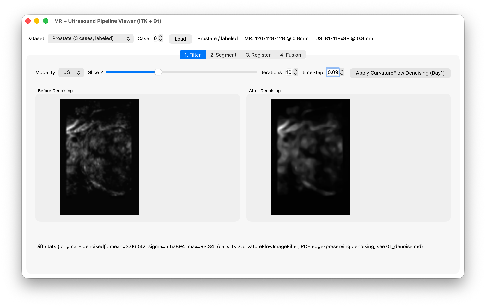
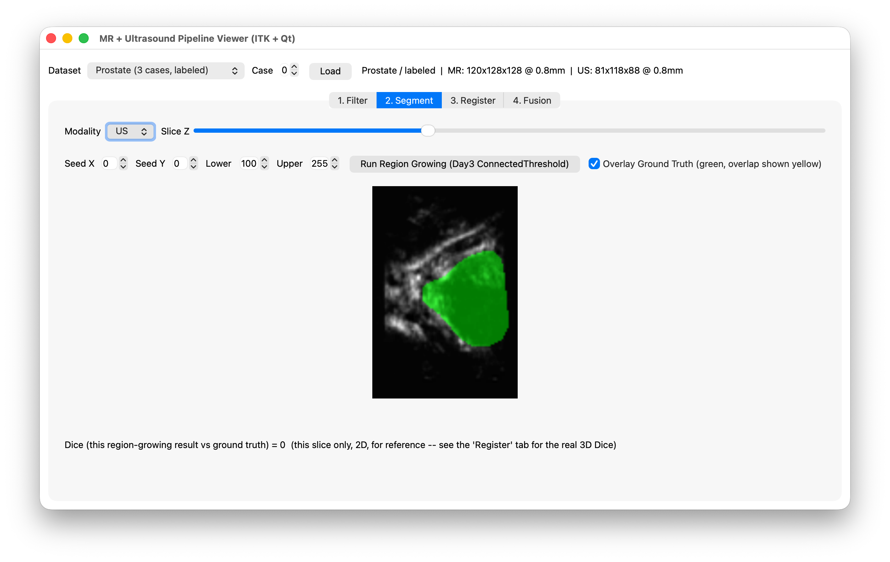
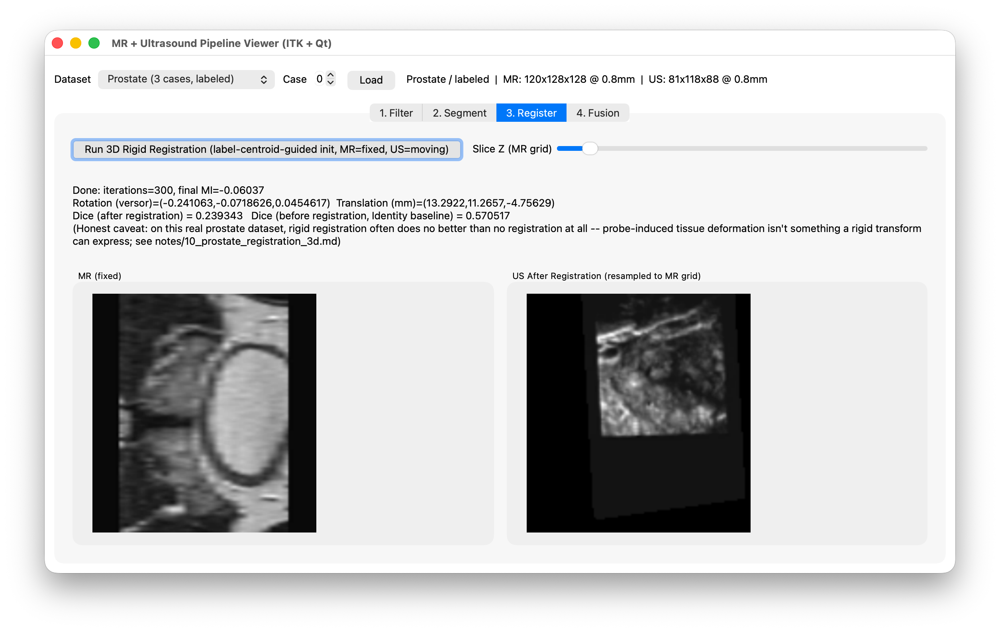
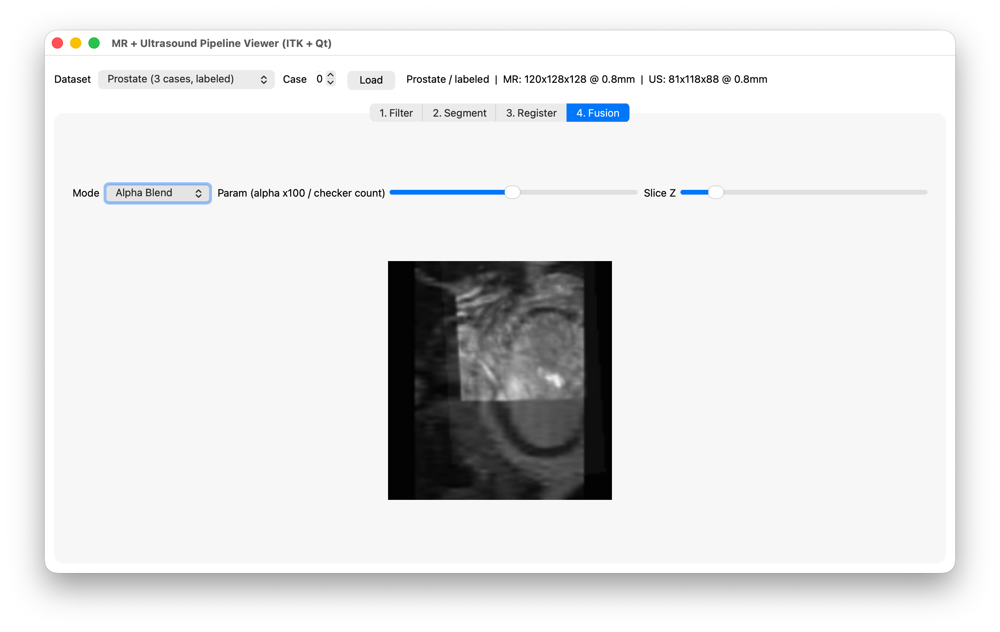

# MR + Ultrasound Fusion Viewer

A Qt6 Widgets application for an MR + ultrasound image fusion pipeline — denoising, segmentation, rigid registration, and fusion display — built on ITK, with an MVVM architecture (`src/model/`, `src/viewmodel/`, `src/view/`) and views defined in Qt Designer `.ui` files.

Four tabs, each a real algorithm run on real data (not a mock UI):

1. **Filter** — `itk::CurvatureFlowImageFilter` edge-preserving denoising
2. **Segment** — `itk::ConnectedThresholdImageFilter` region growing, with optional ground-truth overlay and Dice score
3. **Register** — 3D rigid registration (`VersorRigid3DTransform` + `MattesMutualInformationImageToImageMetricv4` + multi-resolution pyramid), label-centroid-guided initialization when segmentation labels are available
4. **Fusion** — alpha blend / checkerboard display of the registered result

Demo data is bundled in `data/` (one BITE brain MR+US case, three prostate MR+US cases with segmentation labels), so the app runs immediately after cloning — no external downloads needed.

## Screenshots

**1. Filter** — `CurvatureFlowImageFilter` denoising, before/after + diff statistics


**2. Segment** — region-growing segmentation with ground-truth overlay (green = ground truth, red = result, yellow = overlap) and per-slice Dice


**3. Register** — 3D rigid registration with an honest result: on this real prostate dataset, Dice after registration (0.24) is often *lower* than the no-registration baseline (0.57), because probe-induced tissue deformation isn't something a rigid transform can express


**4. Fusion** — alpha-blended overlay of the registered MR and ultrasound volumes


## Dependencies

All installed via [Homebrew](https://brew.sh) on macOS:

| Package | Purpose | Tested version |
|---|---|---|
| `itk` | Image filtering, segmentation, registration | 5.4.7 |
| `qt` | Qt6 Widgets UI framework | 6.11.2 |
| `cmake` | Build configuration | ≥ 3.16 (tested 4.4.3) |
| `ninja` | Build backend | 1.13.2 |

Plus the Xcode Command Line Tools (for the macOS SDK and `clang`).

```bash
xcode-select --install   # if not already installed
brew install itk qt cmake ninja
```

> This project is developed and tested on macOS. It only uses portable ITK/Qt APIs, but Linux/Windows builds haven't been verified — the one macOS-specific bit is the SDK auto-detection in `CMakeLists.txt` (see below), which is a no-op on other platforms.

## Build & run

```bash
git clone <your-repo-url>
cd mrus-fusion-viewer
cmake -G Ninja -B build -S .
ninja -C build
./build/mrus-fusion-viewer
```

No extra `-D` flags should be needed. `CMakeLists.txt` finds ITK and Qt6 via Homebrew's standard CMake package registration (`/opt/homebrew/lib/cmake/...`), and auto-detects the correct macOS SDK itself (see next section) — pass `-DITK_DIR=...`/`-DQt6_DIR=...` explicitly only if `find_package` can't locate them on your machine (e.g. a non-default Homebrew prefix).

### A macOS-specific gotcha this project works around automatically

Homebrew's `itk`/`vtk` bottles are built against the **Command Line Tools** SDK, not whichever SDK Xcode bundles by default. If those two SDKs don't match, you get a cryptic libc++ header error (`<cstddef> tried including <stddef.h> but didn't find libc++'s <stddef.h> header`) or `isnan`/`isinf` errors from VTK. IDEs like Qt Creator auto-detect the Xcode SDK by default and will hit this.

`CMakeLists.txt` handles this itself — before `project()` runs, it asks `xcrun` for the Command Line Tools SDK path and pins `CMAKE_OSX_SYSROOT` to it, unless you've already set that variable explicitly. So a plain `cmake -B build -S .` (from the command line **or** from Qt Creator) should just work. If you ever do need to override it, pass `-DCMAKE_OSX_SYSROOT=/path/to/sdk` and the auto-detection steps aside.

## Opening in Qt Creator

Open `CMakeLists.txt` directly as a project (`File → Open File or Project...`). Qt Creator will run its own CMake configure using whichever kit you pick — the SDK auto-detection above applies there too, so no manual kit tweaking should be required.

## Project layout

```
src/
  model/       ITK-only business logic (no Qt Widgets, no UI) — case loading, denoise/segment/
               registration services, ITK-image-to-QImage conversion
  viewmodel/   QObject-derived, one per tab (+ a shared CaseViewModel) — orchestrate Model calls,
               expose Qt signals/slots carrying display-ready QImage/QString to the View
  view/        QWidget/QMainWindow subclasses + hand-written .ui files — wire widget signals to
               ViewModel slots and ViewModel signals to widget updates; no business logic here
data/
  bite_nifti/  1 BITE brain MR+US case (no segmentation labels)
  prostate/    3 prostate MR+US cases (mr_images/mr_labels/us_images/us_labels), with labels
```

Data paths are resolved at compile time via the `MRUS_VIEWER_DATA_DIR` macro (set in `CMakeLists.txt` to `${CMAKE_SOURCE_DIR}/data`) — there are no hardcoded absolute paths in `src/`, so the app works after a clone to any location.
